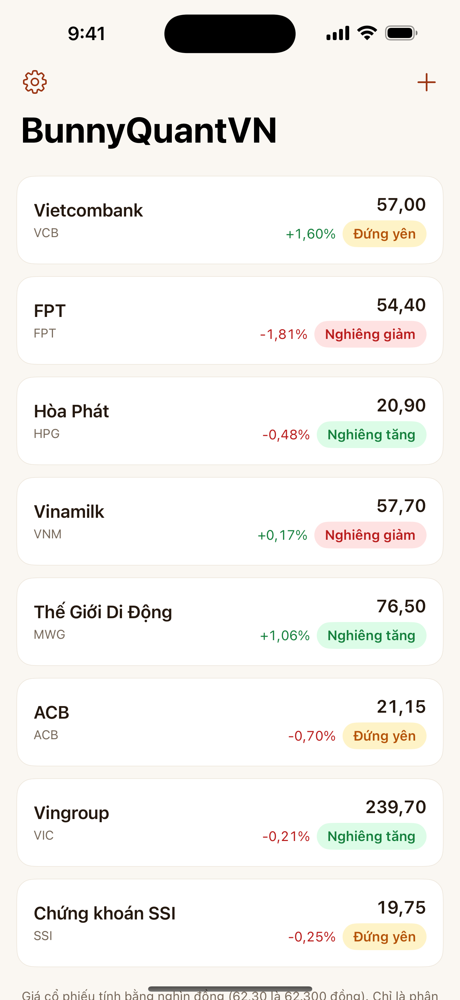
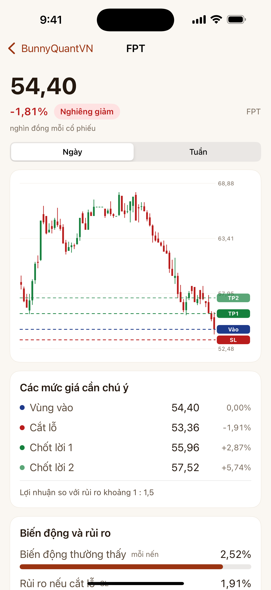
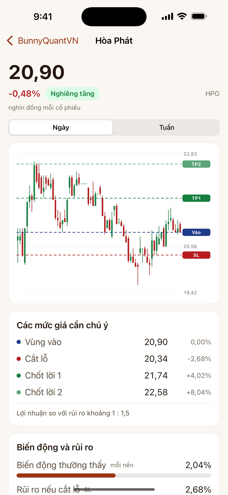
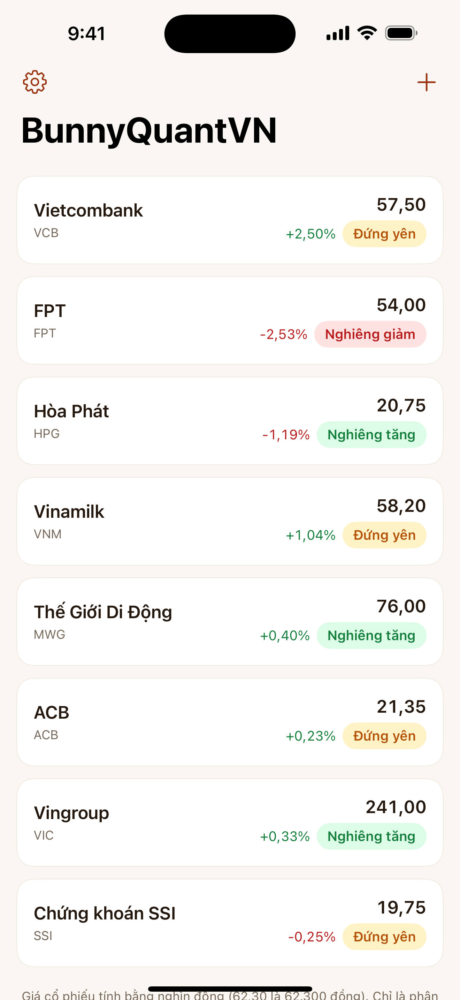
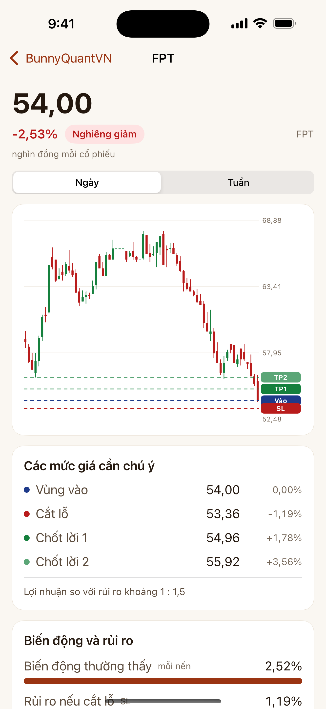
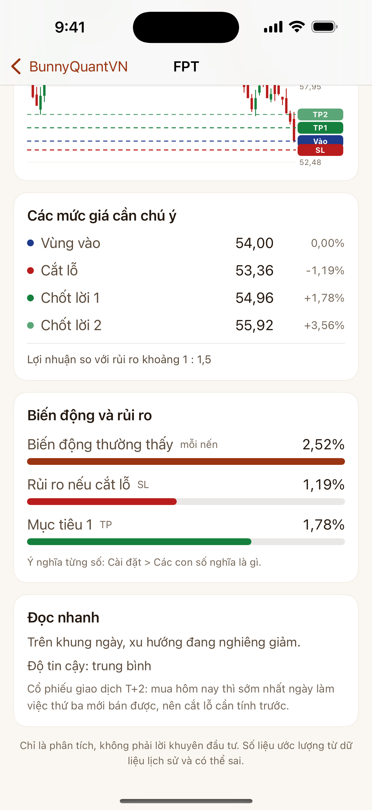
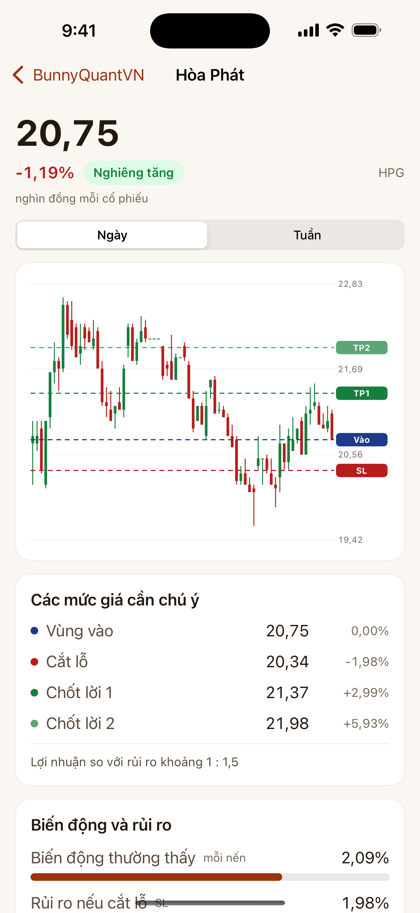

# BunnyQuantVN cho iPhone và iPad

**Developer: Dr. Nam H. Le** · © 2026 Dr. Nam H. Le · [drnamlabs.com](https://drnamlabs.com) · [bunnyquant.vn](https://bunnyquant.vn)

Ứng dụng Swift / SwiftUI của BunnyQuant cho thị trường Việt Nam: danh sách VN30, biểu đồ nến vẽ bằng SwiftUI Canvas, vùng vào, cắt lỗ, chốt lời và thẻ biến động và rủi ro. Miễn phí; mỗi lần cài có một tài khoản ẩn danh riêng, xác minh bằng Apple App Attest.

  

Source published for reading and portfolio purposes only; all rights reserved (see `LICENSE`). The analysis runs on private servers and is not part of this repository.

---

<!-- Dr. Nam H. Le. drnamlabs.com, bunnyquant.com -->
# BunnyQuantVN (Swift)

App iPhone và iPad cho thị trường Việt Nam, Swift thuần (SwiftUI, không thư viện ngoài), bundle `com.bunnyquant.vn`, miễn phí, không đăng nhập.
Bản chị em của app BunnyQuant (US) ở repo bunnyquant, đổi dữ liệu sang backend VN, giao diện tiếng Việt, logo và màu riêng (đỏ cờ, vàng).

## Chạy thế nào
Mỗi lần cài, app xin máy chủ một tài khoản riêng: `GET /api/ios/challenge` -> `POST /api/ios/register` (khóa App Attest + attestation, `clientDataHash` = SHA256 của chuỗi
challenge) -> phiên Supabase; `POST /api/ios/refresh` để gia hạn. Token nằm trong Keychain. Các lệnh còn lại dùng `Authorization: Bearer`.

| Màn hình | Gọi |
|---|---|
| Danh sách theo dõi | `GET/POST /api/theo-doi`, `DELETE /api/theo-doi/{mã}` (gieo sẵn 8 mã VN30 một lần mỗi lần cài) |
| Thêm mã | `GET /api/danh-muc/VN30`, hoặc gõ mã |
| Mã: nến, vùng vào, SL, TP | `GET /api/phan-tich/{mã}?khung=1d\|1w&bo_qua_co_ban=true&xac_suat=false&da_khung=false&so_lan_mo_phong=500` (nến ở `chuoi_nen`, mức giá ở `ket_luan.gia_muc_tieu`) |
| Xóa tài khoản | `DELETE /api/tai-khoan` |

Kết quả giữ trên máy tới hết ngày (giờ Việt Nam) hoặc hết tuần, nên mở lại app không tốn lượt. Hết lượt (HTTP 429) chỉ báo "hôm nay vậy là đủ rồi".
Cố ý KHÔNG có: tên gói, giá, nâng cấp, tên phương pháp, đăng nhập, mua trong app, đặt lệnh, phái sinh (cần gói bổ sung nên không hiện cả ổ khóa).

## Build
```
cd ios-swift && xcodegen
xcodebuild -project BunnyQuantVN.xcodeproj -scheme BunnyQuantVN -configuration Release -destination "generic/platform=iOS" build
```
Simulator không có App Attest: Debug trỏ vào `appstore/screenshot_stub.py` (`BQ_API_BASE=http://127.0.0.1:8099`), cờ `-debugOpen FPT`, `-debugSheet settings|add`.
Logo: `brand/*.svg` (nguồn), icon 1024 không alpha đã render trong `Assets.xcassets`. Trang App Store: `appstore/listing-vi.md`.

## Ảnh màn hình

Nến là giá thật lấy từ dữ liệu thị trường công khai; các đường vào, cắt lỗ, chốt lời trong ảnh là số minh họa, không phải kết quả của máy chủ thật. Ứng dụng chỉ có giao diện sáng, theo thiết kế.






Danh sách theo dõi · Biểu đồ nến với vùng vào, cắt lỗ, chốt lời · Các mức giá cần chú ý và thẻ biến động và rủi ro · Một mã khác
